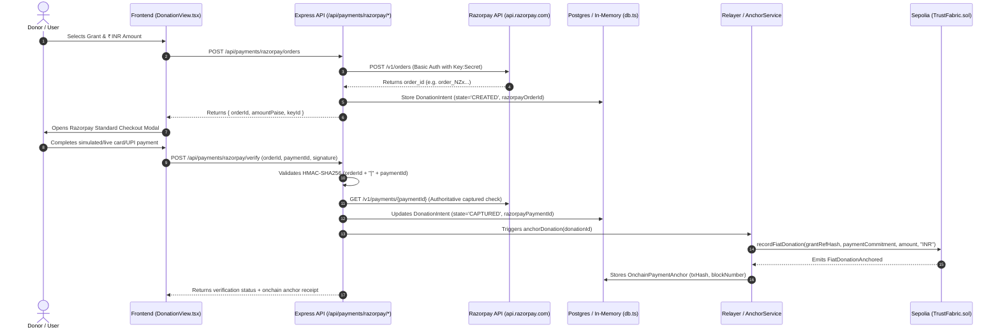

# TrustFabric — Decentralization Audit & Centralization Assessment

**Audit Date:** October 26, 2026  
**Auditor:** Senior Web3 Architect, Solidity Security Auditor, Decentralized Payments Specialist & Full-Stack Engineer  
**Target Repository:** TrustFabric (`/Users/harshshinde/Downloads/PS4`)  
**Target Standard:** CASCADE '26 Theme 4 Problem 4.2 ("The Black Hole Ledger — Verifiable NGO Fund Flows")  
**Document:** `DECENTRALIZATION_AUDIT.md`

---

## 1. Executive Summary & Verification of Repository Claims

This audit rigorously verifies every claim regarding TrustFabric's current decentralization state against the actual source code, smart contracts, backend pipelines, database migrations, and frontend components.

### Verification of Baseline Claims Against Codebase

| Claimed Capability | Source Code Verification | Verified Architecture State | Centralization Classification |
|---|---|---|---|
| **Ethereum Smart Contract (`TrustFabric.sol`)** | [`smart ledger/contracts/evm/TrustFabric.sol:1-432`](file:///Users/harshshinde/Downloads/PS4/smart%20ledger/contracts/evm/TrustFabric.sol) | Unified Solidity 0.8.20 contract deployed on Sepolia (`0x71C25bf4e37da4b7F2eFe341F21074eAf7096eF4`). | **Decentralized Protocol** (Immutable EVM bytecode) |
| **Direct ETH Donations with Forwarding** | [`TrustFabric.sol:164-193`](file:///Users/harshshinde/Downloads/PS4/smart%20ledger/contracts/evm/TrustFabric.sol#L164-L193) & [`web3DonationService.ts:1-444`](file:///Users/harshshinde/Downloads/PS4/smart%20ledger/frontend/src/services/web3DonationService.ts) | Fully functional on-chain payable function `donate(bytes32 campaignId)` with non-reentrant direct ETH forwarding to recipient address. | **Decentralized Protocol** |
| **Fiat Donation Processing (Razorpay)** | [`razorpayService.ts:1-450`](file:///Users/harshshinde/Downloads/PS4/server/src/services/razorpayService.ts) & [`paymentRoutes.ts:1-366`](file:///Users/harshshinde/Downloads/PS4/server/src/routes/paymentRoutes.ts) | Server-side Orders API (`https://api.razorpay.com/v1/orders`), webhook HMAC verification, and client checkout popup. | **Centralized Provider (CRITICAL BOTTLENECK)** |
| **IPFS Evidence Storage & Pinning** | [`ipfsStorageService.ts:1-480`](file:///Users/harshshinde/Downloads/PS4/server/src/services/ipfsStorageService.ts) & `.evidence_vault/ipfs/` | Pure TypeScript Base32 CIDv1 (`bafkrei...`) engine with local vault, Pinata cloud pinning, and 4-tier gateway fallback. | **Hybrid** (Decentralized content-addressing + Centralized pinning/gateways) |
| **Relational State Persistence** | [`dbPersistenceService.ts:1-563`](file:///Users/harshshinde/Downloads/PS4/server/src/services/dbPersistenceService.ts) & [`supabase/migrations/`](file:///Users/harshshinde/Downloads/PS4/supabase/migrations) | PostgreSQL schema (15 tables) via Supabase/Prisma with in-memory fallback map for offline test execution. | **Centralized Provider / Self-Hosted** |
| **Authentication & User Management** | [`clerkService.ts:1-240`](file:///Users/harshshinde/Downloads/PS4/server/src/services/clerkService.ts) & [`jwtService.ts:1-80`](file:///Users/harshshinde/Downloads/PS4/server/src/services/jwtService.ts) | Clerk authentication and custom JWT bearer token middleware in [`authMiddleware.ts`](file:///Users/harshshinde/Downloads/PS4/server/src/middleware/authMiddleware.ts). | **Centralized Provider** |
| **Backend Ingestion, OCR & Merkle Batching** | [`liveRelayerPipeline.ts:1-498`](file:///Users/harshshinde/Downloads/PS4/server/src/services/liveRelayerPipeline.ts) & [`ocrEngine.ts:1-250`](file:///Users/harshshinde/Downloads/PS4/server/src/services/ocr/ocrEngine.ts) | Asynchronous BullMQ worker queue with Tesseract.js OCR and deterministic Keccak256 sorted-pair Merkle tree batcher. | **Self-Hosted Infrastructure** |
| **Soroban Smart Contract Implementation** | [`redTeamEngine.ts:1-240`](file:///Users/harshshinde/Downloads/PS4/smart%20ledger/frontend/src/services/redTeamEngine.ts) | TypeScript emulation of Soroban escrow rules (PS42-R01 to PS42-R20); no compiled Rust WASM contract deployed on Stellar. | **Simulation / Demo-Only** |

---

## 2. Phase 1 — Comprehensive Trace of the Existing Razorpay Integration

A file-by-file investigation was conducted to trace every dependency, import, API route, data structure, and UI element coupled to Razorpay.

### Dependency Flow Diagram



### Razorpay Component Inventory & File Map

| Component / File Path | Lines | Responsibility / Function | Essential to Core Protocol? | Can Be Safely Removed or Decoupled? |
|---|---|---|---|---|
| [`smart ledger/frontend/index.html`](file:///Users/harshshinde/Downloads/PS4/smart%20ledger/frontend/index.html#L18) | 18 | Loads external script `<script src="https://checkout.razorpay.com/v1/checkout.js"></script>` | **No** (Blocks page load if Razorpay CDN is blocked/down) | **Yes.** Remove script tag or load conditionally only for legacy fiat flows. |
| [`smart ledger/frontend/src/services/paymentService.ts`](file:///Users/harshshinde/Downloads/PS4/smart%20ledger/frontend/src/services/paymentService.ts#L1-L269) | 1-269 | `createOrder()`, `verifyPayment()`, `getDonationProof()`, `retryAnchor()`. Manages Razorpay order lifecycle. | **Partial** (Contains legacy order/verify methods) | **Yes.** Refactor to support direct Web3/crypto and offline auditable bank settlement. |
| [`smart ledger/frontend/src/components/DonationView.tsx`](file:///Users/harshshinde/Downloads/PS4/smart%20ledger/frontend/src/components/DonationView.tsx#L51-L345) | 51-345 | State machine for `handleStartCheckout()` using `window.Razorpay()`. | **Partial** (Already has `METAMASK_SEPOLIA` tab!) | **Yes.** Make Web3 MetaMask the default; replace Razorpay modal with decentralized Web3 flow and auditable direct bank flow. |
| [`server/src/services/razorpayService.ts`](file:///Users/harshshinde/Downloads/PS4/server/src/services/razorpayService.ts#L1-L450) | 1-450 | Core integration: HTTP Basic Auth to Razorpay REST API, orders creation, payment capture confirmation, webhook HMAC verification. | **Centralized Gateway Logic** | **Yes.** Isolate into legacy compatibility module; decouple from mandatory donation path. |
| [`server/src/routes/paymentRoutes.ts`](file:///Users/harshshinde/Downloads/PS4/server/src/routes/paymentRoutes.ts#L71-L170) | 71-170 | `POST /api/payments/razorpay/orders`, `POST /api/payments/razorpay/verify`, `POST /api/webhooks/razorpay`. | **Gateway Routes** | **Yes.** Keep legacy read endpoints; decouple live checkout from requiring active Razorpay credentials. |
| [`server/src/services/anchorService.ts`](file:///Users/harshshinde/Downloads/PS4/server/src/services/anchorService.ts#L15-L42) | 15-42 | `generatePaymentCommitment()` uses `intent.razorpayPaymentId \|\| intent.razorpayOrderId` in SHA-256 preimage. | **Data Format Coupling** | **Yes.** Abstract commitment schema to support on-chain tx hashes and verifiable bank reference numbers. |
| [`server/src/types.ts`](file:///Users/harshshinde/Downloads/PS4/server/src/types.ts#L16-L45) | 16-45 | `DonationIntent` has mandatory fields `razorpayOrderId` and optional `razorpayPaymentId`; `RazorpayWebhookEvent`. | **Type Schema** | **Yes.** Make `razorpayOrderId` optional; introduce `paymentMethod: 'CRYPTO_ETH' \| 'CRYPTO_STABLECOIN' \| 'DIRECT_BANK_AUDIT' \| 'RAZORPAY_LEGACY'`. |
| [`server/src/config.ts`](file:///Users/harshshinde/Downloads/PS4/server/src/config.ts#L8-L35) | 8-35 | Enforces `RAZORPAY_KEY_ID`, `RAZORPAY_KEY_SECRET`, and crashes on boot if `RAZORPAY_MODE=live` without credentials. | **Configuration Gate** | **Yes.** Make Razorpay credentials optional so server boots cleanly without any Razorpay accounts. |
| [`server/tests/payment.test.ts`](file:///Users/harshshinde/Downloads/PS4/server/tests/payment.test.ts#L1-L324) | 1-324 | 14 automated tests for Razorpay order creation, HMAC validation, and webhooks. | **Test Suite** | **Preserve.** Retain to ensure legacy backwards-compatibility while adding new decentralized tests. |
| [`supabase/migrations/20260225010000_razorpay_fiat_anchor.sql`](file:///Users/harshshinde/Downloads/PS4/supabase/migrations/20260225010000_razorpay_fiat_anchor.sql#L15-L58) | 15-58 | Tables `donation_intents` and `razorpay_webhook_events`. | **Database Schema** | **Preserve & Extend.** Alter column `razorpay_order_id` to allow `NULL` for pure crypto donations. |

---

## 3. Phase 2 — Architectural Evaluation of Payment Alternatives

To eliminate Razorpay as a centralized single point of failure without breaking usability, three distinct models were evaluated:

### Detailed Comparative Analysis

| Evaluation Criterion | Option A: Direct EVM Cryptocurrency (Native ETH) | Option B: EVM Stablecoin (ERC-20 USDT/USDC) | Option C: Non-Razorpay INR (Verifiable Direct Bank / UPI Audit) |
|---|---|---|---|
| **Decentralization Level** | **100% Fully Decentralized** | **95% Decentralized Protocol** (Centralized issuer freeze risk for USDT/USDC) | **Hybrid / Centralized Banking Rails** (Auditable settlement) |
| **Trust Model** | Trustless. Trust enforced entirely by EVM consensus and smart contract bytecode. | Trustless smart contract execution; trust in stablecoin issuer collateral and contract blacklist. | Trust in banking clearinghouse (RBI / NPCI) + independent auditor attestation. |
| **Intermediary Reliance** | None. Direct wallet-to-contract interaction (`msg.sender` → `recipient`). | None at runtime (requires standard ERC-20 `transferFrom` or Permit). | Commercial bank (SBI/HDFC/ICICI), manual accountant, or custom bank statement parser. |
| **Smart Contract Footprint** | **Already implemented and deployed** in [`TrustFabric.sol:donate()`](file:///Users/harshshinde/Downloads/PS4/smart%20ledger/contracts/evm/TrustFabric.sol#L164-L193). | Requires contract update or companion escrow contract with SafeERC20 and allowlist. | Anchors SHA-256 commitment on-chain via [`TrustFabric.sol:recordFiatDonation()`](file:///Users/harshshinde/Downloads/PS4/smart%20ledger/contracts/evm/TrustFabric.sol#L100). |
| **Transaction Fees** | Native gas fees on Sepolia (negligible) or Ethereum Mainnet / L2 Arbitrum/Base ($0.01 - $1.50). | Token transfer gas + approval gas (two transactions or 1 EIP-2612 Permit). | 0% gateway fees (UPI is zero-fee in India; IMPS/NEFT is negligible). |
| **User Experience** | Instant for Web3 users (MetaMask, Rainbow, Coinbase Wallet). Barrier for non-crypto donors. | Stable value eliminates crypto volatility; requires wallet and token approval. | Extremely familiar to Indian donors; requires manual bank reference submission. |
| **Settlement Time** | Real-time on-chain finality (12 seconds on Ethereum, ~2 seconds on L2s). | Real-time on-chain finality. | Instant payment via UPI; 1-24 hours for manual accounting reconciliation. |
| **Regulatory & Tax Exposure** | Subject to Indian VDA (Virtual Digital Asset) tax rules (Section 115BBH) if converted by NGO. | Subject to VDA regulations; requires NGO to have crypto custody framework. | Fully compliant with 80G tax exemption, FCRA compliance, and standard INR accounts. |

### Architectural Recommendation
1. **Primary Protocol Path (Web3 Native):** **Option A (Direct EVM Native ETH)** as the default, fully decentralized payment rail. It is already implemented in [`TrustFabric.sol`](file:///Users/harshshinde/Downloads/PS4/smart%20ledger/contracts/evm/TrustFabric.sol) and [`web3DonationService.ts`](file:///Users/harshshinde/Downloads/PS4/smart%20ledger/frontend/src/services/web3DonationService.ts) and has zero gateway fees, zero counterparty risk, and instant cryptographic settlement.
2. **Practical Fallback Path (Fiat Donors):** **Option C (Auditable Direct Bank / UPI Transfer with Cryptographic Proofs)**. Eliminates third-party commercial payment aggregators (Razorpay), allows donors to transfer directly to the verified NGO bank account, submits the canonical bank reference (UTR/RRN), generates a privacy-preserving nullifier commitment on-chain, and prevents duplicate claims across NGOs.

---

## 4. Phase 3 & 6 — System-Wide Centralization & Infrastructure Audit

A comprehensive decentralization audit must distinguish between decentralization rhetoric and actual operational dependencies.

### Comprehensive Infrastructure Classification

```
┌────────────────────────────────────────────────────────────────────────┐
│                      TRUSTFABRIC SYSTEM BOUNDARIES                     │
├───────────────────────────────┬────────────────────────────────────────┤
│ COMPONENT                     │ DECENTRALIZATION CLASSIFICATION        │
├───────────────────────────────┼────────────────────────────────────────┤
│ 1. EVM Smart Contract         │ DECENTRALIZED PROTOCOL                 │
│ 2. Direct Crypto Donations    │ DECENTRALIZED PROTOCOL                 │
│ 3. Merkle Proof Verification  │ DECENTRALIZED PROTOCOL (On-Chain)      │
│ 4. IPFS Content Addressing    │ DECENTRALIZED PROTOCOL (CIDv1)         │
│ 5. Pinata Remote Pinning      │ CENTRALIZED CLOUD PROVIDER             │
│ 6. Public IPFS Gateways       │ HYBRID / FEDERATED                     │
│ 7. Local IPFS Vault           │ SELF-HOSTED INFRASTRUCTURE             │
│ 8. PostgreSQL Database        │ CENTRALIZED PROVIDER (Supabase Cloud)  │
│ 9. In-Memory DB Fallback      │ LOCAL RUNTIME                          │
│ 10. Clerk Authentication      │ CENTRALIZED PROVIDER (Proprietary SaaS)│
│ 11. Razorpay Payment Gateway  │ CENTRALIZED PROVIDER (Single Point)    │
│ 12. Ethereum RPC Provider     │ CENTRALIZED / HYBRID (PublicNode/Infura)│
│ 13. Relayer Private Key       │ CENTRALIZED OPERATOR (Single Signer)   │
│ 14. Tesseract OCR Engine      │ SELF-HOSTED INFRASTRUCTURE (Worker)    │
│ 15. Soroban Escrow Engine     │ SIMULATION / DEMO-ONLY (TypeScript)    │
└───────────────────────────────┴────────────────────────────────────────┘
```

### Critical Centralization Points & Vulnerabilities

#### 1. The Relayer as a Centralized Trusted Operator
- **Location:** [`server/src/services/liveRelayerPipeline.ts:64-140`](file:///Users/harshshinde/Downloads/PS4/server/src/services/liveRelayerPipeline.ts#L64-L140)
- **Current Behavior:** Merkle roots and fiat commitments are committed on-chain exclusively by an `authorizedRelayer` address managed by a single server private key (`SEPOLIA_RELAYER_PRIVATE_KEY`).
- **Decentralization Risk:** If the server is offline or the relayer key is depleted of Sepolia ETH, no batch roots can be anchored on-chain.
- **Auditing Mitigation:** Even if the relayer is offline, direct ETH donations (`donate()`) bypass the relayer completely and execute directly peer-to-peer!

#### 2. Public IPFS Privacy vs. Auditability Conflict
- **Location:** [`server/src/services/ipfsStorageService.ts:310-360`](file:///Users/harshshinde/Downloads/PS4/server/src/services/ipfsStorageService.ts#L310-L360)
- **Current Behavior:** Invoice files, vendor receipts, and expense metadata are converted into raw CIDv1 multihashes and pinned to Pinata and public gateways (`ipfs.io`, `dweb.link`).
- **Privacy Risk:** IPFS is a public broadcast network. Any party possessing the CID can download the complete document. If invoices contain vendor PAN, GSTIN, bank account numbers, or patient healthcare records, publishing unencrypted documents to IPFS violates GDPR, India's DPDP Act 2023, and financial privacy norms.
- **Remediation:** Invoices must be client-side encrypted using AES-256-GCM before CID generation. Only the encrypted ciphertext is pinned to IPFS; the decryption key is shared only with verified auditors via public-key envelope encryption (ECIES).

#### 3. Supabase / PostgreSQL vs. IPFS Boundary
- **Current Behavior:** Relational state (NGO applications, grant limits, user roles, nullifier indexes) resides in PostgreSQL.
- **Architectural Requirement:** IPFS cannot and should not replace PostgreSQL. IPFS has no indexing, no SQL query capabilities, and no atomicity. PostgreSQL must be retained as the indexed cache, while on-chain smart contracts and IPFS serve as the verifiable immutable source of truth.

#### 4. Clerk Authentication Dependency
- **Location:** [`server/src/middleware/authMiddleware.ts`](file:///Users/harshshinde/Downloads/PS4/server/src/middleware/authMiddleware.ts)
- **Current Behavior:** User identity is tied to Clerk SaaS. If Clerk experiences an outage or blocks an account, authenticated operations fail.
- **Decentralization Improvement:** Enable Web3 SIWE (Sign-In with Ethereum / EIP-4361) so donors and auditors can authenticate directly using their cryptographic wallet keypair without any third-party auth service.

---

## 5. Phase 5 — Verification Hierarchy: Distinguishing Payment Realities

To maintain complete audit integrity, TrustFabric must never conflate on-chain execution with off-chain gateway signals.

```
┌────────────────────────────────────────────────────────────────────────┐
│                    TRUSTFABRIC VERIFICATION HIERARCHY                  │
├──────┬────────────────────────────┬────────────────────────────────────┤
│ TIER │ STATUS LABEL               │ VERIFIABILITY & SOURCE OF TRUTH    │
├──────┼────────────────────────────┼────────────────────────────────────┤
│ L1   │ ONCHAIN_CONFIRMED          │ Verified on-chain via EVM receipt, │
│      │                            │ block inclusion & DonationReceived │
│      │                            │ event log. Zero off-chain trust.   │
├──────┼────────────────────────────┼────────────────────────────────────┤
│ L2   │ MERKLE_BATCH_ANCHORED      │ Off-chain batch root committed on  │
│      │                            │ Sepolia. Independent inclusion     │
│      │                            │ proof verified via smart contract. │
├──────┼────────────────────────────┼────────────────────────────────────┤
│ L3   │ DIRECT_BANK_ATTESTED       │ Off-chain INR settlement verified  │
│      │                            │ via bank statement/UTR nullifier   │
│      │                            │ and multi-sig auditor attestation. │
├──────┼────────────────────────────┼────────────────────────────────────┤
│ L4   │ GATEWAY_VERIFIED (LEGACY)  │ Off-chain payment reported captured│
│      │                            │ by Razorpay API or webhook.        │
│      │                            │ Relies on centralized processor.   │
├──────┼────────────────────────────┼────────────────────────────────────┤
│ L5   │ SIMULATED_TEST_MODE        │ Test sandbox order / dummy hash    │
│      │                            │ generated in local offline demo.   │
└──────┴────────────────────────────┴────────────────────────────────────┘
```

---

## 6. Audit Conclusion & Identified Action Items

1. **Razorpay is not architecturally necessary for TrustFabric's core value proposition.** Direct crypto donations on Sepolia already exist in the smart contract and frontend.
2. **Razorpay can be cleanly decoupled** by making its environment variables optional, removing its mandatory CDN script tag, promoting Direct EVM donations to primary status, and providing an auditable direct bank settlement alternative.
3. **Historical Razorpay records must remain readable** in the database and audit trail so past donor records are never broken or retroactively altered.
4. **The implementation roadmap must proceed to `PAYMENT_MIGRATION_PLAN.md`.**
