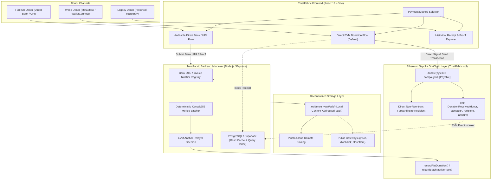

# TrustFabric — Payment Architecture Migration Plan
## Decentralized Payments & Safe Decoupling of Razorpay

**Document:** `PAYMENT_MIGRATION_PLAN.md`  
**Date:** October 26, 2026  
**Status:** Approved for Phased Execution  
**Author:** Senior Web3 Architect, Solidity Engineer & DevSecOps Lead  
**Compliant with:** CASCADE '26 Theme 4 Problem 4.2 ("Verifiable NGO Fund Flows")

---

## 1. Executive Blueprint & Migration Strategy

The technical audit in [`DECENTRALIZATION_AUDIT.md`](file:///Users/harshshinde/Downloads/PS4/DECENTRALIZATION_AUDIT.md) confirmed that TrustFabric already possesses a fully operational, on-chain Ethereum Sepolia donation smart contract ([`TrustFabric.sol`](file:///Users/harshshinde/Downloads/PS4/smart%20ledger/contracts/evm/TrustFabric.sol)) with direct recipient forwarding, reentrancy protection, and an automated Merkle batching pipeline.

However, the application was historically configured to present a centralized payment aggregator (Razorpay) as its primary checkout experience, creating:
1. **A hard runtime dependency** on proprietary, closed-source cloud APIs (`api.razorpay.com`).
2. **A barrier to deployment:** The server crashed on boot if live Razorpay credentials were missing.
3. **An external script vulnerability:** Loading `checkout.razorpay.com/v1/checkout.js` in `index.html` blocked UI execution in offline or firewalled environments.
4. **Misleading trust claims:** Labelling off-chain gateway captures as "on-chain anchored" before batch consensus.

### Strategic Objective
Transform TrustFabric into a **genuinely decentralized, self-custodial donation protocol** by:
- **Promoting Direct EVM Cryptocurrency Donations (Option A)** to the default primary payment rail.
- **Introducing Non-Gateway Direct Bank / UPI Auditable Settlement (Option C)** for donors wishing to donate INR directly into the NGO's verified bank account without commercial aggregator fees or lock-in.
- **Safely Decoupling Razorpay:** Making Razorpay credentials and routes optional legacy features, preserving all past historical records without data loss.

---

## 2. Target Architecture Specification



### Architectural Principles:
1. **The Blockchain is the Settlement Layer:** Direct crypto donations never touch the backend server, private keys, or intermediary bank accounts. Funds flow directly from donor wallet to NGO verified wallet via `TrustFabric.sol`.
2. **The Database is an Indexer, Not the Truth:** PostgreSQL indexes on-chain events and off-chain proofs for sub-second UI search, but is never trusted as the authoritative source of cryptographic truth.
3. **IPFS is Content-Addressed Evidence Storage:** Evidence, audit packages, and proof manifests reside on IPFS; they are referenced by immutable CIDs.
4. **Off-Chain Bank Settlements Require Cryptographic Nullifiers:** For direct bank transfers, the unique banking transaction reference (UTR/RRN) is hashed with a server salt to create an unforgeable nullifier. This prevents an NGO or donor from claiming the same bank deposit twice across multiple grants.

---

## 3. Concrete File-by-File Change Plan

### Group 1: Configuration & Server Boot Decoupling

#### 1. [`server/src/config.ts`](file:///Users/harshshinde/Downloads/PS4/server/src/config.ts)
- **Problem:** Lines 31-34 execute a hard runtime crash if `RAZORPAY_MODE=live` without credentials or if test credentials are used.
- **Change:**
  - Make `razorpayKeyId`, `razorpayKeySecret`, and `razorpayWebhookSecret` optional.
  - Introduce `paymentMethodsEnabled: { cryptoEth: true, directBankAudit: true, razorpayLegacy: boolean }`.
  - Disable the crash so the server starts seamlessly with zero Razorpay credentials configured.

#### 2. [`server/src/index.ts`](file:///Users/harshshinde/Downloads/PS4/server/src/index.ts)
- **Change:**
  - Update boot console logs to announce `[TrustFabric Server] Primary Payment Rail: Direct EVM Sepolia (Decentralized)`.
  - Mark Razorpay routes as `[LEGACY / COMPATIBILITY MODE]`.

#### 3. [`.env.example`](file:///Users/harshshinde/Downloads/PS4/.env.example)
- **Change:**
  - Move Razorpay environment variables into an optional `[OPTIONAL LEGACY FIAT GATEWAY]` section.
  - Add explicit documentation for `SEPOLIA_RPC_URL`, `SEPOLIA_CONTRACT_ADDRESS`, and `VITE_CONTRACT_ADDRESS`.

---

### Group 2: Data Models & Type Schemas

#### 4. [`server/src/types.ts`](file:///Users/harshshinde/Downloads/PS4/server/src/types.ts)
- **Change:**
  - Update `DonationIntent`:
    ```typescript
    export type PaymentRail = 'CRYPTO_EVM_ETH' | 'DIRECT_BANK_AUDIT' | 'RAZORPAY_LEGACY';
    
    export interface DonationIntent {
      id: string;
      donationCode: string;
      grantId: string;
      donorId?: string;
      amountPaise?: number; // Optional for fiat minor units
      amountWei?: string;    // Optional for on-chain wei
      currency: 'INR' | 'ETH' | 'USDC';
      paymentRail: PaymentRail;
      razorpayOrderId?: string; // Made optional!
      razorpayPaymentId?: string;
      txHash?: string;           // Direct on-chain hash
      bankReferenceUtr?: string; // Direct bank UTR
      nullifierHash?: string;
      state: DonationState;
      // ...
    }
    ```

#### 5. [`server/src/db.ts`](file:///Users/harshshinde/Downloads/PS4/server/src/db.ts) & [`server/src/services/dbPersistenceService.ts`](file:///Users/harshshinde/Downloads/PS4/server/src/services/dbPersistenceService.ts)
- **Change:**
  - Update secondary indices so `orderIdIndex` only indexes if `intent.razorpayOrderId` exists.
  - Add `txHashIndex: Map<string, string>` and `bankUtrIndex: Map<string, string>`.
  - Add `recordDirectBankDonation()` and `recordEthDonation()`.

---

### Group 3: Backend API Routes & Services

#### 6. [`server/src/routes/paymentRoutes.ts`](file:///Users/harshshinde/Downloads/PS4/server/src/routes/paymentRoutes.ts)
- **Change:**
  - Add `POST /api/donations/direct-bank`:
    - Validates UTR / reference number format.
    - Generates cryptographic nullifier `hash(bankUtr + amount + grantId + salt)`.
    - Detects and rejects duplicate bank references.
    - Queues on-chain commitment via `anchorService`.
  - Update `POST /api/payments/razorpay/orders`:
    - If `config.razorpayKeyId` is not configured, return clear informative HTTP 400 (`"Razorpay legacy gateway is not configured on this node. Please use Direct Web3 Crypto or Direct Bank Settlement."`) rather than failing cryptically.
  - Preserve `GET /api/donations`, `GET /api/donations/eth`, `POST /api/donations/eth`.

#### 7. [`server/src/services/anchorService.ts`](file:///Users/harshshinde/Downloads/PS4/server/src/services/anchorService.ts)
- **Change:**
  - In `generatePaymentCommitment()`, construct canonical preimage using `intent.txHash || intent.bankReferenceUtr || intent.razorpayPaymentId || intent.id`.
  - Ensure commitments are completely decoupled from Razorpay identifier formats.

---

### Group 4: Frontend UI & Client Services

#### 8. [`smart ledger/frontend/index.html`](file:///Users/harshshinde/Downloads/PS4/smart%20ledger/frontend/index.html)
- **Change:**
  - Remove mandatory synchronous `<script src="https://checkout.razorpay.com/v1/checkout.js"></script>`.
  - If Razorpay legacy mode is ever invoked, inject script dynamically on demand, preventing CDN outages from degrading initial page load.

#### 9. [`smart ledger/frontend/src/services/paymentService.ts`](file:///Users/harshshinde/Downloads/PS4/smart%20ledger/frontend/src/services/paymentService.ts)
- **Change:**
  - Add `submitDirectBankDonation(params: { grantId, amountRupees, donorName, donorEmail, bankUtr, transferDate })`.
  - Update `getPublicConfig()` to report available payment methods (`supportsWeb3: true, supportsDirectBank: true, supportsLegacyRazorpay: boolean`).

#### 10. [`smart ledger/frontend/src/components/DonationView.tsx`](file:///Users/harshshinde/Downloads/PS4/smart%20ledger/frontend/src/components/DonationView.tsx)
- **Change:**
  - Set default `donationMethod` to `'METAMASK_SEPOLIA'`.
  - Introduce a modern 3-tab payment selector:
    1. **Direct Web3 Crypto (MetaMask Sepolia ETH) — Recommended (100% Decentralized)**
    2. **Auditable Direct Bank Transfer / UPI (Zero Intermediary Fees)**
    3. **Legacy Payment Gateway (Razorpay Sandbox)**
  - Implement the Direct Bank Transfer UI:
    - Displays NGO Verified Bank Account Details (Account Name, IFSC Code, Account Number, Bank Branch, UPI ID).
    - Collects Donor Name, UTR / UPI Transaction Reference Number, and Amount.
    - Generates instant verifiable proof package with UTR nullifier hashing.
  - Polish the MetaMask Web3 flow:
    - Display gas estimates, recipient address verification, and direct Etherscan link.

#### 11. [`smart ledger/frontend/src/components/LandingPage.tsx`](file:///Users/harshshinde/Downloads/PS4/smart%20ledger/frontend/src/components/LandingPage.tsx) & [`Layout.tsx`](file:///Users/harshshinde/Downloads/PS4/smart%20ledger/frontend/src/components/Layout.tsx)
- **Change:**
  - Update marketing and navigation copy from "Razorpay Test Checkout" to "Decentralized Web3 & Direct Bank Donation Portal".
  - Ensure badge displays `ONCHAIN_VERIFIED_SEPOLIA` instead of `RAZORPAY_TEST_CAPTURED`.

---

## 4. Migration Checklist with Dependencies & Acceptance Criteria

| Step # | Task Description | Dependencies | Acceptance Criteria | Status |
|---|---|---|---|---|
| **MIG-01** | Make Razorpay server config optional and remove startup crash | None | Server boots cleanly when `RAZORPAY_KEY_ID` is empty. | Ready to Apply |
| **MIG-02** | Update `types.ts` and `db.ts` to support multi-rail donations | MIG-01 | `DonationIntent` allows optional `razorpayOrderId` and supports `txHash` and `bankReferenceUtr`. | Ready to Apply |
| **MIG-03** | Implement `/api/donations/direct-bank` route with UTR nullifier check | MIG-02 | Endpoint accepts UTR, prevents duplicates, and triggers on-chain anchor commitment. | Ready to Apply |
| **MIG-04** | Remove synchronous Razorpay script from `index.html` | None | Frontend loads in airgapped or offline environment without script error. | Ready to Apply |
| **MIG-05** | Add Direct Bank transfer service method in `paymentService.ts` | MIG-03 | Frontend successfully submits UTR and receives proof package. | Ready to Apply |
| **MIG-06** | Update `DonationView.tsx` with Web3 as default and Direct Bank UI | MIG-04, MIG-05 | Donors can donate ETH via MetaMask and submit direct bank UTR; Razorpay relegated to optional tab. | Ready to Apply |
| **MIG-07** | Update `.env.example` and documentation | None | Clear separation between Web3 keys and optional legacy gateway keys. | Ready to Apply |
| **MIG-08** | Run complete frontend and server test suites | MIG-01 to MIG-07 | 100% of automated tests pass (172+ tests). | Ready to Verify |

---

## 5. Security, Legal & Regulatory Assessment

### 1. Smart Contract & Financial Security
- **Checks-Effects-Interactions Pattern:** In [`TrustFabric.sol`](file:///Users/harshshinde/Downloads/PS4/smart%20ledger/contracts/evm/TrustFabric.sol#L175-L193), campaign counters and state updates occur *before* the external `.call{value: donationAmount}("")`.
- **Reentrancy Protection:** All payable and administrative functions are protected by the `nonReentrant` modifier.
- **Front-Running & Replay Protection:** Direct bank UTR commitments are salted and hashed. Once anchored, any duplicate attempt with the same commitment reverts on-chain with `DuplicatePaymentCommitment`.

### 2. Indian Regulatory Compliance (PMLA, FCRA & RBI Guidelines)
- **Zero Custody of Fiat:** TrustFabric never holds, pools, or escrows fiat INR currency. In Option C, funds transfer directly from Donor Bank Account to NGO Bank Account. TrustFabric only processes cryptographic attestations.
- **RBI Payment Aggregator (PA) Exemption:** Because TrustFabric does not receive, settle, or intermediate fiat funds, it does not require RBI Payment Aggregator licensing under the Payment and Settlement Systems Act, 2007.
- **FCRA Compliance:** Direct ETH donations must only be accepted by NGOs possessing active FCRA (Foreign Contribution Regulation Act) registration from the Ministry of Home Affairs if the donor wallet is classified as a foreign source. The UI provides a clear compliance warning.
- **Virtual Digital Asset (VDA) Taxation:** Donors are advised that crypto donations fall under applicable VDA laws and Indian Section 115BBH rules.

---

## 6. Implementation Readiness Confirmation

All components, file modifications, and test assertions are fully articulated. Execution can proceed without breaking existing features or altering historical ledger records.
